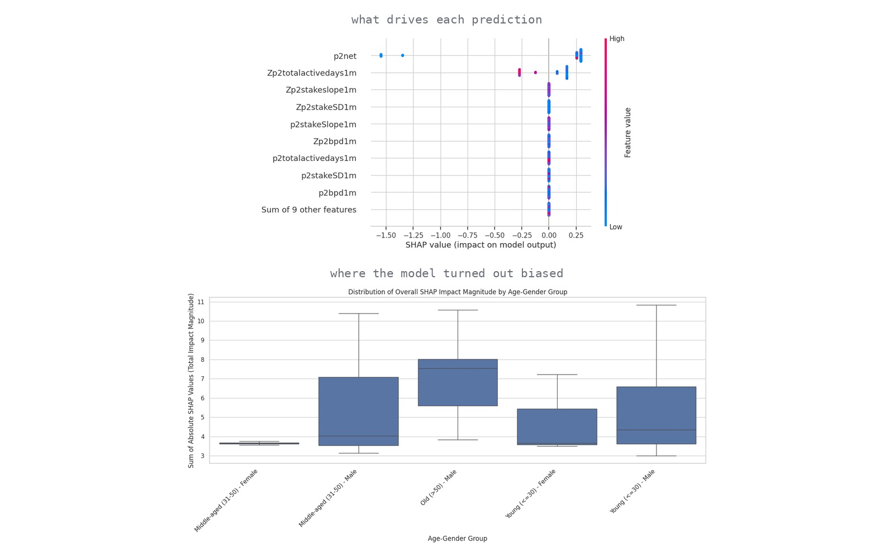

# BetWise — gambling-risk classification

Prototype medical device software that classifies self-reported online-gambling
behaviour into four risk levels, with SHAP used both for per-prediction explanation
and for a fairness audit of the model.

Laboratory of Medical Devices and Systems, BSc in Artificial Intelligence —
University of Pavia, University of Milano-Bicocca, University of Milan, June 2025.

Team project with Chiara Bosi and Leonardo Castelli.
My contribution: model code, technical documentation, class presentation.

*Left: SHAP beeswarm across the four risk classes. Right: fairness audit by age and gender group.*

## Task

BetWise is designed as a plugin for the Italian public-services app IO. A user
completes a short questionnaire about their betting behaviour; the responses are sent
to a server-side classifier, which assigns one of four risk profiles and returns
tailored feedback, including a recommendation to seek professional consultation in
the highest-risk case.

The system does not diagnose. It is a decision-support tool operating under human
oversight.

## Target definition

The four classes correspond to the behavioural clusters identified by
Braverman & Shaffer (2012) on real online sports-betting data:

| Class | Profile | Associated risk |
|---|---|---|
| 1 | High intensity, high variability in wager size | Highest |
| 2 | Very low first-month activity | Problem-adjacent |
| 3 | High intensity, stable wager size | Lower |
| 4 | Moderate, infrequent betting (majority of users) | Lowest |

The classifier is trained on the same underlying dataset, so the task is supervised
prediction of cluster membership for a new user.

## Data

18 tabular features, of which 14 retained; two categorical (reason for account
closure, gender), the rest numerical. No missing values. Both labels and categorical
features are heavily imbalanced: class 4 dominates, classes 1 and 2 are rare, and
male users outnumber female ones. Numerical features are a mix of normal and skewed
distributions, handled by a preprocessing pipeline covering both cases.

## Model selection

Nested cross-validation over a search space of 60 configurations:

- **Sampler:** none, SMOTE, RandomOverSampler
- **Dimensionality reduction:** none, PCA, LDA, sequential forward selection
- **Classifier:** perceptron, logistic regression, KNN, random forest, XGBoost

The five best configurations were retrained and evaluated on held-out data. All
ensemble methods overfitted, so the configuration selected was not the one with the
highest training score but the one generalising best: **XGBoost with no oversampling
and no dimensionality reduction**.

Hyperparameter search over number of estimators, learning rate and depth returned
`XGBClassifier(learning_rate=0.1, max_depth=8, n_estimators=50)`, reaching **F1 ≈ 0.93**.
The learning curve shows residual overfitting, but test F1 converges and remains
stable as training examples increase.

F1 was preferred over MCC for interpretability in a clinical decision-support context.

## Explainability and fairness

**Per-prediction explanation.** Beeswarm, bar and violin plots per class show that
`p2net` (net expenditure on live bets) dominates across all four classes, while gender
and `Zp2totalactivedays1m` are specifically relevant for classes 2 and 4.

**Fairness audit.** Users were grouped by age (<30, 31–50, >50) and gender, and the
distribution of total absolute SHAP magnitude compared across groups. The audit
identified:

- systematically higher feature-importance scores for older users
- wider SHAP variance for male predictions than female ones
- compounded sensitivity for the "Old Male" and "Middle-aged Male" intersections

These findings are documented in the device technical file together with the
mitigations: human oversight, pre- and post-deployment bias audits, and continuous
SHAP monitoring.

## Regulatory classification

Under MDR 2017/745 Annex VIII Rule 11, BetWise is **Class IIa medical device
software**: it informs decisions with a diagnostic purpose without controlling therapy
or posing irreversible risk. It is not an in vitro diagnostic device, as it analyses
behavioural rather than biological data. Under the AI Act it qualifies as a high-risk
system.

Data handling follows GDPR: explicit consent at first launch, purpose limitation, data
minimisation, anonymisation or deletion when no longer needed, encryption and access
control, and a documented human-in-the-loop design.

## Stack

`xgboost` · `scikit-learn` · `imbalanced-learn` · `mlxtend` · `SHAP` · `pandas` ·
`numpy` · `scipy` · `seaborn` · `matplotlib` · `missingno`

## Limitations

The model predicts cluster membership, not a clinical diagnosis; no ground-truth
diagnosis exists in the data, which also means retraining is only possible if
clinicians supply confirmed labels. The identified age and gender bias is documented
but not corrected. Robustness testing was omitted on the grounds that the
questionnaire uses bounded, predefined response ranges, so out-of-distribution inputs
cannot occur by construction.

## References

Braverman J., Shaffer H.J. *How do gamblers start gambling: identifying behavioural
markers for high-risk internet gambling.* European Journal of Public Health, 2012.

LaBrie R. et al. *Assessing the Playing Field: A Prospective Longitudinal Study of
Internet Sports Gambling Behavior.* Journal of Gambling Studies, 2007.
